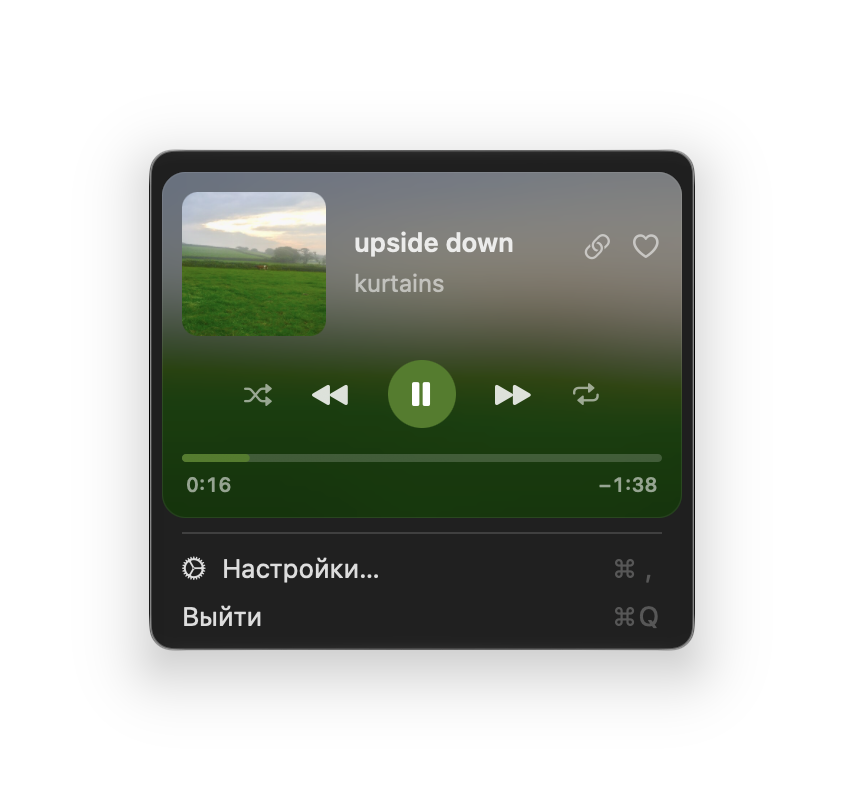
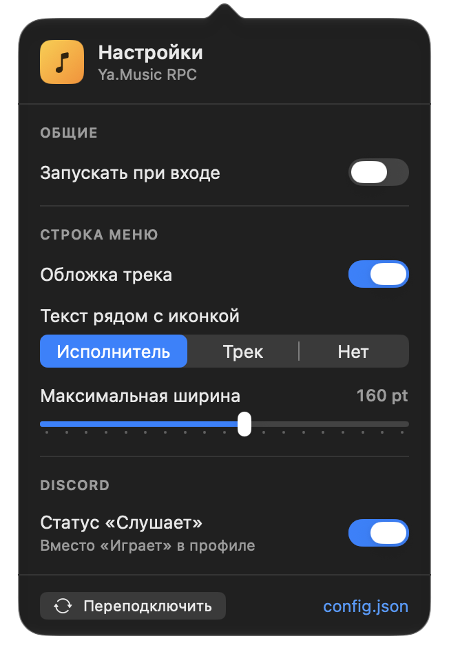

# Ya.Music RPC

**Discord Rich Presence для десктопной Яндекс Музыки + мини-плеер в строке меню macOS.**



> 🇬🇧 English summary is [below](#english).

## Возможности

- **Discord Rich Presence**: «Слушает <трек>», исполнитель, обложка и полоса прогресса. На паузе прогресс скрывается.
- **Виджет в строке меню**: миниатюра обложки и текст (исполнитель или название трека, ширину можно менять).
- **Карточка по клику**: большая обложка, исполнитель, альбом, прогресс и время.
- **Управление плеером из карточки**: пауза/плей, следующий и предыдущий трек, перемотка, «Нравится», shuffle, повтор, копирование ссылки на трек, открытие Яндекс Музыки по клику на обложку.
- **Окно настроек** в стиле macOS и файл `config.json` для тонкой настройки.
- **Автозапуск при входе** (LaunchAgent).
- **Без зависимостей**: только Swift, нужен лишь `swiftc` из Command Line Tools. Без Xcode, Homebrew, Node и Python.
- Диагностика: флаги `--diagnose` и `--verbose`.



## Как это работает

Десктопная Яндекс Музыка — Electron-приложение, а Discord и системный Now Playing не дают стороннему приложению прочитать трек напрямую. Поэтому:

1. Приложение отправляет процессу Яндекс Музыки сигнал `SIGUSR1`, и Node открывает инспектор на `127.0.0.1:9229`. Перезапускать музыку не нужно, воспроизведение не прерывается.
2. Через Chrome DevTools Protocol в окно плеера внедряется небольшой скрипт, который читает метаданные (Media Session) и время из `<audio>`.
3. Discord получает активность через локальный IPC-сокет (`discord-ipc-0`).

Всё происходит локально. Токены Яндекса и аккаунт не нужны, ничего не отправляется на сторонние серверы (обложка подтягивается по ссылке с `avatars.yandex.net`).

## Установка

1. Скачай `Ya.Music-RPC.dmg` из [Releases](../../releases).
2. Перетащи **Ya.Music RPC** в **Applications** и запусти.
3. Приложение подписано ad-hoc (без платного сертификата Apple), поэтому при первом запуске macOS может сказать «не удаётся проверить разработчика». Нажми **правый клик → «Открыть» → «Открыть»**. Или в терминале:
   ```bash
   xattr -dr com.apple.quarantine "/Applications/Ya.Music RPC.app"
   ```
4. Иконка появится в строке меню (в доке её нет). Яндекс Музыка должна быть запущена.

В Discord проверь: **Настройки → Игровая активность → «Отображать текущую активность как статус»**.

Требования: macOS 13+, Apple Silicon (сборка под arm64).

## Сборка из исходников

```bash
git clone <repo-url> && cd <repo>
./build.sh && open "build/Ya.Music RPC.app"   # только приложение
./package.sh && open build/Ya.Music-RPC.dmg   # приложение + DMG
```

Иконка лежит в `Resources/AppIcon.icns`.

## Настройки

Большая часть — в окне «Настройки…» из меню: автозапуск, обложка и текст в строке меню, ширина, статус «Слушает».
Остальное — в `~/.config/ya-music-rpc/config.json` (перечитывается на лету):

| Ключ | По умолчанию | Что делает |
|---|---|---|
| `discordClientId` | `""` | Твой Discord Application ID (или переменная окружения `YA_MUSIC_RPC_CLIENT_ID`, она важнее). Пусто — присутствие в Discord не включится, в логе будет предупреждение |
| `menuBarMaxChars` | `34` | Предел длины текста в строке меню |
| `showCoverInMenuBar` | `true` | Миниатюра обложки |
| `showTextInMenuBar` | `true` | Текст рядом с обложкой |
| `menuBarText` | исполнитель | `artist` или `title` |
| `menuBarMaxWidth` | `130` | Ширина текста, pt |
| `pollIntervalSeconds` | `1.0` | Частота опроса плеера |
| `inspectorPort` | `9229` | Порт инспектора Яндекс Музыки |
| `discordCoverSize` | `400` | Размер обложки для Discord |
| `menuCoverSize` | `600` | Размер обложки в карточке |
| `useListeningActivityType` | `true` | «Слушает» вместо «Играет» |
| `showSearchButton` | `false` | Кнопка со ссылкой на поиск трека |

### Свой Discord Application ID

Без своего ID Discord не даёт показать присутствие, поэтому создай приложение (бесплатно, пара минут):

1. Открой <https://discord.com/developers/applications> → **New Application**.
2. **Название приложения — это то, что увидят друзья** в статусе (например, `Яндекс Музыка`).
3. На вкладке **General Information** скопируй **Application ID**.
4. Впиши его в `discordClientId` в `~/.config/ya-music-rpc/config.json` или задай переменную окружения:
   ```bash
   export YA_MUSIC_RPC_CLIENT_ID=123456789012345678
   ```
5. Нажми «Переподключить» в настройках приложения.

Картинки загружать не нужно: обложка трека передаётся ссылкой на `avatars.yandex.net`, поэтому ключи Rich Presence art assets не требуются.

Если ID не задан, приложение работает как мини-плеер в строке меню, а в Discord ничего не отправляет; предупреждение видно в логе и в `--diagnose`.

## FAQ и проблемы

Диагностика:

```bash
"/Applications/Ya.Music RPC.app/Contents/MacOS/YaMusicRPC" --diagnose
```

Лог: `~/.config/ya-music-rpc/log.txt` (подробный — запуск с `--verbose`).

- **В Discord пусто.** Проверь, что Discord запущен и включён показ активности. Нажми «Переподключить» в настройках.
- **«Invalid Client ID».** Application ID неверный или удалён. Заведи свой (см. выше).
- **«Порт 9229 занят».** Закрой посторонний Node-процесс или поменяй `inspectorPort` (должен совпадать с портом Электрона).
- **Вместо «Слушает» показывает «Играет».** Не все версии Discord поддерживают тип «Слушает», поставь `useListeningActivityType: false`.
- **Перестало работать после обновления Яндекс Музыки.** Метод опирается на включённый в сборке Electron инспектор (проверено на версии 5.112.0). Если Яндекс его отключит, способ перестанет работать.
- **Автозапуск недоступен.** Он выключен, пока приложение запущено прямо из DMG. Скопируй его в Applications.

## Дисклеймер

Неофициальный проект. Не связан с «Яндексом» и Discord и не одобрен ими. «Яндекс Музыка» и Discord — торговые марки их владельцев. Используй на свой риск.

## Лицензия

[MIT](LICENSE)

---

## English

**Ya.Music RPC** is an unofficial macOS menu-bar app that shows what you're playing in the **Yandex Music desktop app** as a **Discord Rich Presence** and as a mini player in the menu bar (cover, artist/title, progress, playback controls).

**How it works:** it sends `SIGUSR1` to the running Electron app to enable the Node inspector on `127.0.0.1:9229`, reads playback state over Chrome DevTools Protocol (no restart needed), and talks to Discord via its local IPC socket. No Yandex account or token is needed.

**Install:** download the DMG from Releases, drag to Applications. The app is ad-hoc signed: right-click → Open on first launch, or `xattr -dr com.apple.quarantine "/Applications/Ya.Music RPC.app"`.

**Build:** `./build.sh` (app) or `./package.sh` (app + DMG). Requires Command Line Tools (`swiftc`), macOS 13+, arm64.

**Troubleshooting:** run the binary with `--diagnose`; logs are in `~/.config/ya-music-rpc/log.txt`.

Not affiliated with Yandex or Discord. License: MIT.
